<!--
  SEO: audio spectrum analyzer, real-time FFT visualizer, music visualizer, WASAPI loopback, C# .NET Framework 4.8,
  Windows Forms, BASS, BassWASAPI, dBFS meter, system audio visualizer, oscilloscope, waterfall spectrogram
-->
<p align="center">
  🟢 <b>Real-time FFT</b> · 🔵 <b>WASAPI loopback</b> · 🟣 <b>19 modes</b> · 🟠 <b>13 themes</b> · 🔴 <b>dBFS accurate</b> · 🟡 <b>xUnit tested</b>
</p>
<div align="center" markdown="1">
  <h1>🎚️ Spectrum — Real-Time Audio Spectrum Analyzer &amp; Music Visualizer for Windows</h1>
  <p><strong>A .NET Framework Windows Forms visualizer for real-time system-audio analysis, with 83 logarithmic bands and 19 live visualization modes.</strong></p>
  <p><code>▁ ▂ ▃ ▅ ▇ █ ▇ ▅ ▃ ▂ ▁ &nbsp; S P E C T R U M &nbsp; ▁ ▂ ▃ ▅ ▇ █ ▇ ▅ ▃ ▂ ▁</code></p>
  <table>
    <tr>
      <td></td>
      <td></td>
      <td></td>
      <td></td>
    </tr>
  </table>
  <p><strong>83 logarithmic bands</strong> · <strong>19 visualization modes</strong> · <strong>13 colour themes</strong> · <strong>60 FPS rendering target</strong></p>
</div>
A C# .NET Framework 4.8 Windows Forms application that captures your system's audio output in real time and renders it as an animated frequency spectrum using 83 vertical bars. Audio capture is handled by BASS and BassWASAPI via Windows WASAPI loopback, and an FFT-based band analyzer measures each bar in dBFS — so it works as both a **real-time audio visualizer for music** and a readable **C# FFT spectrum analyzer implementation** you can study, with a deterministic xUnit test suite.

---

<a id="overview"></a>

## ⚡ At a Glance

| 🎚️ Frequency Analysis | 🎬 Visualization  |    🎨 Customization    |     ⚡ Presentation      |
| :-------------------: | :---------------: | :--------------------: | :----------------------: |
|     **83 bands**      |   **19 modes**    |     **13 themes**      |    **60 FPS target**     |
|  **20 Hz – 20 kHz**   | Runtime switching | **5 effects + `None`** | **25 ms analysis timer** |

### 🧭 Navigation

[**✨ Features**](#features) · [**🎛️ Modes**](#modes) · [**📸 Screenshots**](#gallery) · [**🪄 Styles**](#styles) · [**🎨 Themes**](#themes) · [**⚙️ Configuration**](#configuration) · [**🏗️ Build**](#build) · [**🧪 Tests**](#tests) · [**📐 Measurement**](#measurement) · [**❓ FAQ**](#faq)

### ⌨️ Keyboard Controls

|            Shortcut            | Action                              |
| :----------------------------: | ----------------------------------- |
| <kbd>Ctrl</kbd> + <kbd>M</kbd> | Cycle visualization modes           |
| <kbd>Ctrl</kbd> + <kbd>T</kbd> | Cycle colour themes                 |
| <kbd>Ctrl</kbd> + <kbd>R</kbd> | Open Fixed/Random rotation settings |
|         <kbd>F12</kbd>         | Toggle always-on-top                |

### 🚀 Quick Start

```text
1. Open Spectrum.sln in Visual Studio 2022 with .NET desktop development tools
2. Restore NuGet packages and build the Release configuration (see Build below)
3. Run Spectrum.exe from Spectrum\bin\Release\
```

> [!TIP]
> Spectrum automatically captures the Windows default audio output through WASAPI loopback, so normal use does not require selecting an input device.

---

<a id="features"></a>

## ✨ Features

> [!NOTE]
> Spectrum combines measurement accuracy, responsive presentation, runtime customization, and automatic device recovery in a single Windows Forms application.

- **83-bar frequency spectrum** with a fixed logarithmic 20 Hz – 20 kHz viewport, labelled frequency axis and a 0 to -72 dBFS level axis on both sides
- **Calibrated spectrum grid** at every 6 dB, with logarithmic frequency guides at 20, 30, 40, 60, 100, 200, 300, 400, 600, 1k, 2k, 3k, 4k, 6k, 10k and 20k Hz; crowded frequency labels are omitted without moving their guides
- **Measured band levels** — each bar is the integrated power of its frequency band in dBFS (see _Measurement_)
- **19 visualization modes** selectable at runtime, with an initial value from `App.config`
- **Optional styles** with a safe `None` default: Pulse, Glow, Trail, Scanline, and Precision are enabled only where their renderer is meaningful
- **13 colour themes** selectable at runtime, including Studio, Platinum Light, and High Contrast instrument palettes
- **Live mode, style, and theme selectors** in the title bar; changes apply immediately without restarting
- **Alphabetical mode discovery** uses case-insensitive current-culture names with a deterministic ordinal tie-break; existing mode identifiers and saved selections are preserved
- **Original vector mode icons** distinguish spectrum, stereo, waveform, matrix, threshold, and history views without bitmap stretching
- **1200 x 480 default client window**, manually resizable without mode-driven size changes, with individually accessible window controls, visible keyboard focus, and descriptive mode tooltips
- **Heat-map colour gradient** with theme-readable peak markers using the theme's primary text colour
- **Independent falling peak markers** with configurable hold/decay, thin horizontal lines and a reserved gap above Spectrum, Bricks and LED bars, including full-scale and segmented-cell boundaries; expiring trails release clearance smoothly instead of causing jumps
- **Asymmetric ballistics** — fast attack, slower release per mode
- **Frame-rate independent animation** — ballistics use elapsed time; the one-shot analysis timer requests a 25 ms delay and restarts after processing, so actual analysis cadence also depends on processing and scheduling. The display targets 60 FPS; achieved control-paint cadence depends on timer scheduling and workload
- **Silence detection** — bars fade out gracefully when no audio is playing
- **Auto device recovery** — restores capture automatically when the default audio device changes
- **Scaling layout** — bars and labels are laid out from the window's client size (the process does not declare per-monitor DPI awareness, so Windows scales it on high-DPI monitors)
- **Keyboard shortcuts** — `Ctrl+M` cycles visualization modes; `Ctrl+T` cycles colour themes
- **Fixed or Random rotation** — choose Fixed to keep selections stable, or Random to change mode, compatible style, and theme together at a configurable 1–240 minute interval (default 5 minutes); preferences are saved per user
- **Rotation settings shortcut** — press `Ctrl+R` to open Fixed/Random and interval settings
- **F12 toggle** — toggle always-on-top
- **Single-instance** — uses a named mutex to prevent multiple instances

Spectrum is an **analyzer, not a player or audio processor**. Its selectors, visual styles, and rotation settings change the display, not the captured audio. It has no playback, pause, stop, mute, master-volume, equalizer, or audio-effect controls, and no user-facing input/output device selector. Control playback and volume in the source application or Windows; Spectrum follows the default render endpoint.

---

<a id="modes"></a>

## 🎛️ Visualization Modes

<div align="center" markdown="1">

`Advanced Spectral Balance` · `Band Matrix` · `Bricks` · `Contour` · `Dynamics History` · `LED` · `Level Change` · `Octave Spectrum` · `Octave Waterfall` · `Oscilloscope`

`Peak Trace` · `Radial Spectrum` · `Spectral Balance` · `Spectral History` · `Spectrum` · `Stereo Levels` · `Stereo Spectrum` · `Threshold Monitor` · `Waterfall`

</div>

Choose a visualization mode from the **Mode** selector in the title bar to change it immediately. The
supported modes are:

| Mode                               | Best For                                                                                                          |
| ---------------------------------- | ----------------------------------------------------------------------------------------------------------------- |
| `Advanced Spectral Balance`        | Seven FFT-measured bands (20 Hz–20 kHz) in dBFS relative to a full-scale sine                                     |
| `Band Matrix`                      | Compact single-frame 83-band matrix with frequency and level labels                                               |
| `Bricks` (configured startup mode) | Retro block aesthetic; 80s/Synthwave music                                                                        |
| `Contour`                          | Connected line across the measured frequency bands                                                                |
| `Dynamics History`                 | Actual front-channel RMS and sample-peak history; unavailable audio intervals remain gaps                         |
| `LED`                              | Segmented frequency-band display; not a calibrated VU/PPM meter                                                   |
| `Level Change`                     | Per-band frame-to-frame displayed-level change; not a power-domain spectral-flux or beat measurement              |
| `Octave Spectrum`                  | Ten grouped octave-range meters; approximate powers reconstructed from displayed band values                      |
| `Octave Waterfall`                 | Scrolling grouped-octave display history                                                                          |
| `Oscilloscope`                     | Actual front-left PCM waveform with a labeled auto-ranging amplitude scale                                        |
| `Peak Trace`                       | Current spectrum with a short frequency-history trace                                                             |
| `Radial Spectrum`                  | Frequency bands arranged around a circle                                                                          |
| `Spectral Balance`                 | Estimated bass/mid/high shares derived from displayed frequency-band power                                        |
| `Spectral History`                 | Perspective stack of genuinely captured display spectra; spacing denotes received frames, not uniform sample time |
| `Spectrum` (fallback)              | Continuous real-time frequency-band analysis                                                                      |
| `Stereo Levels`                    | Independent front-L/R RMS and sample peaks in amplitude-relative dBFS                                             |
| `Stereo Spectrum`                  | Independent front-left and front-right frequency spectra                                                          |
| `Threshold Monitor`                | Current band levels classified around a visible monitoring threshold                                              |
| `Waterfall`                        | Scrolling history of received frequency display frames, not a uniformly sample-timed spectrogram                  |

Retired selections remain compatible through migration: Dots → LED, Wave → Contour, Lollipop/Center/Ambient Particles → Spectrum, Mirror → Bricks, Note Map → Contour, Orbit History/Frequency Ribbon → Peak Trace, and Level Change Map/Transient Map/Spectral Flux → Level Change. These are aliases, not additional selectable modes.

<a id="gallery"></a>

## 📸 Visualization Mode Screenshots

> 🎬 Real screenshots of every mode, captured from the running application (1200 × 480 window, WASAPI loopback of live system audio, `ClassicSmooth` theme, `Precision` style).

### 📊 Spectrum

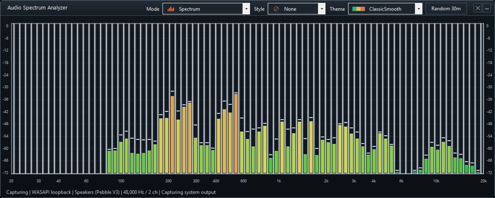

_Classic 83-band real-time frequency spectrum._

### 🧱 Bricks

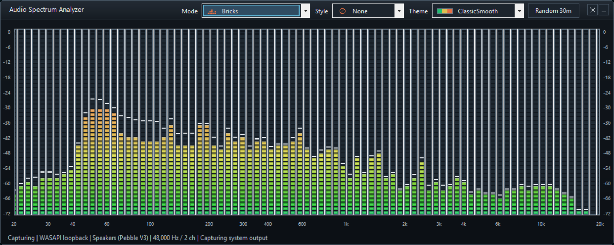

_Retro block-style LED bricks._

### 💡 LED

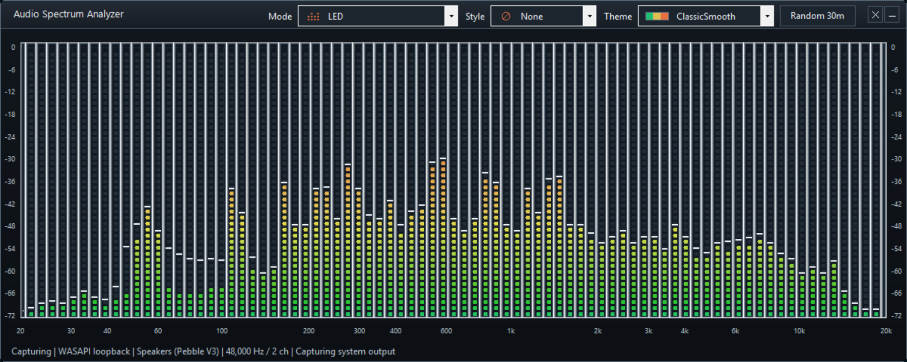

_Segmented LED frequency meter._

### 🔢 Band Matrix

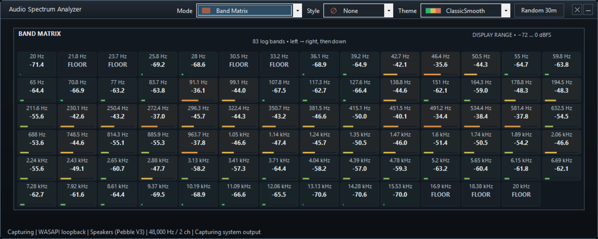

_Compact 83-band matrix with labels._

### 〰️ Contour

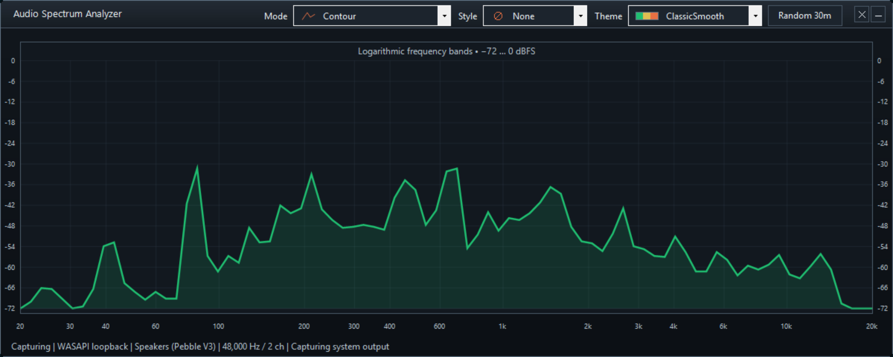

_Connected frequency contour line._

### 📈 Peak Trace

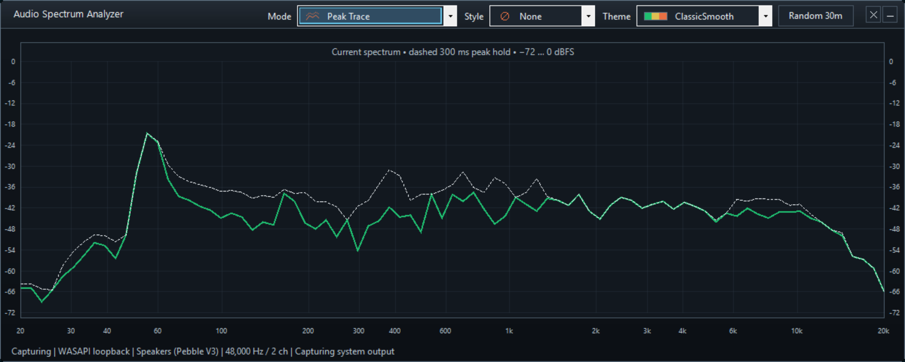

_Spectrum plus short frequency-history trace._

### 🎡 Radial Spectrum

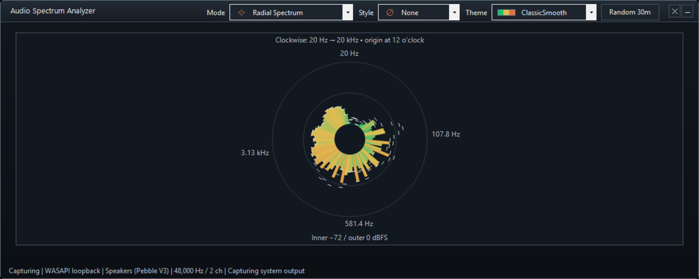

_Frequency bands arranged in a circle._

### 🎧 Stereo Spectrum

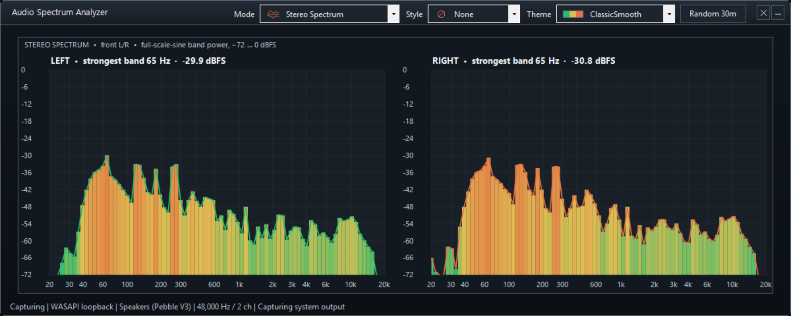

_Independent left/right spectra._

### 🔊 Stereo Levels

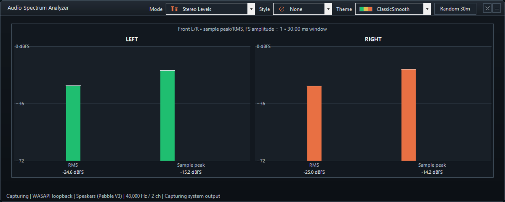

_Front L/R RMS and sample peaks._

### 🌊 Oscilloscope

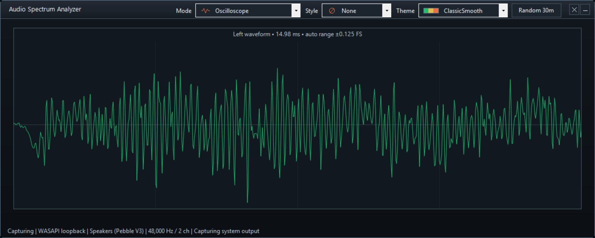

_Front-left PCM waveform._

### 🎼 Octave Spectrum

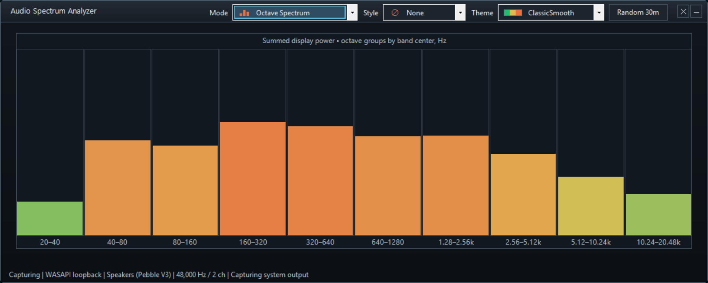

_Ten grouped octave meters._

### 🏞️ Octave Waterfall

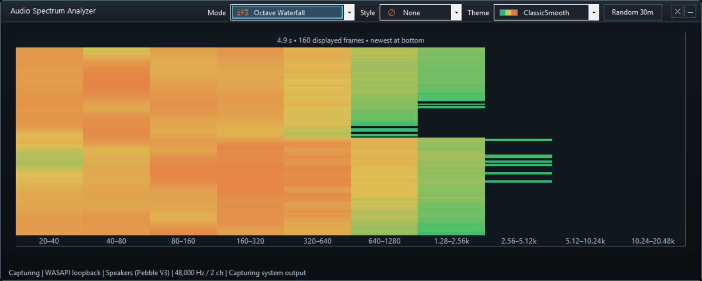

_Scrolling grouped-octave history._

### 🌈 Waterfall

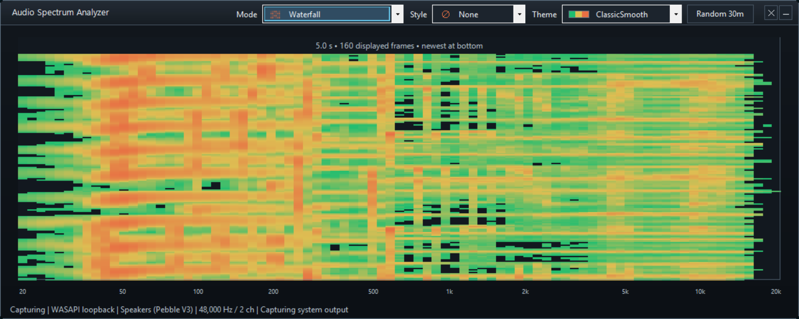

_Scrolling spectrogram-style history._

### 🏔️ Spectral History

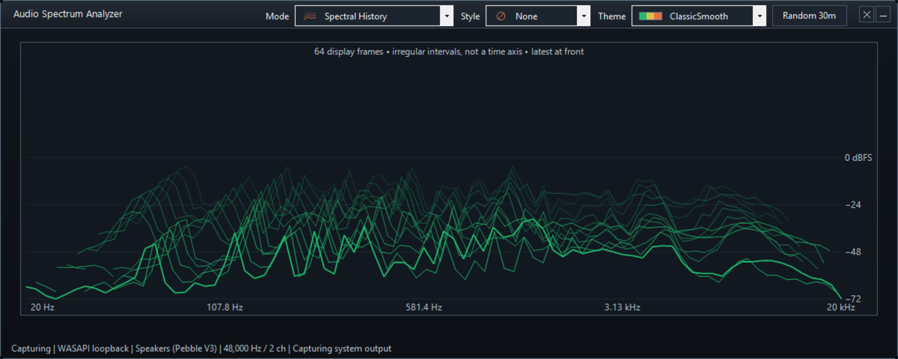

_Perspective stack of captured spectra._

### ⏱️ Dynamics History

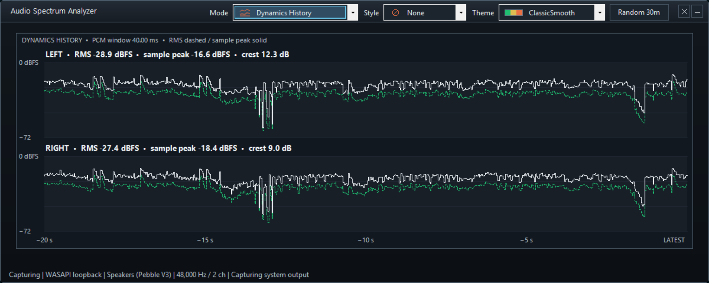

_Front-channel RMS and peak history._

### ⚡ Level Change

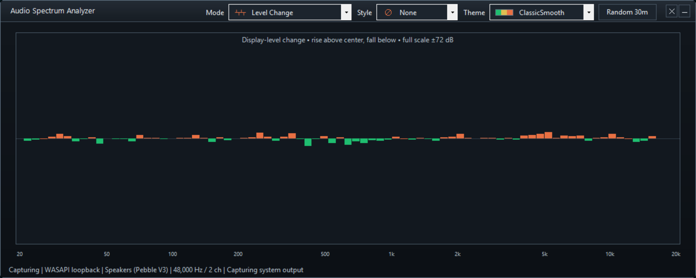

_Per-band frame-to-frame level change._

### 🚦 Threshold Monitor

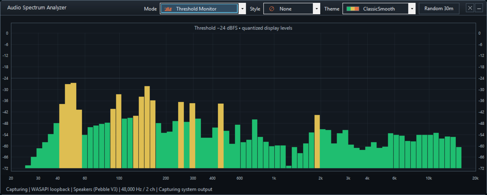

_Band levels around a monitoring threshold._

### ⚖️ Spectral Balance

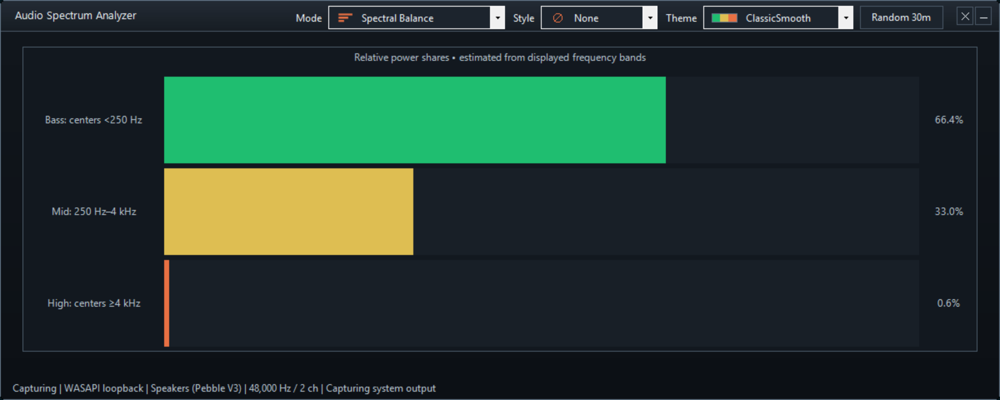

_Bass / mid / high share estimate._

### 🎯 Advanced Spectral Balance

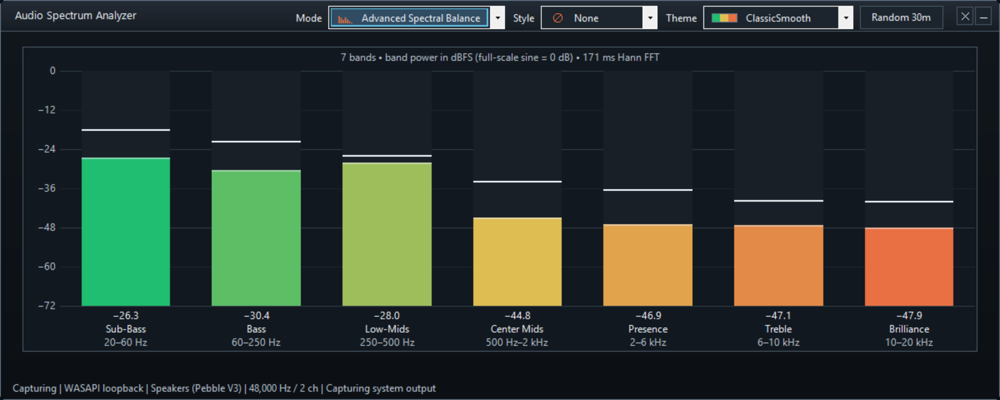

_Seven FFT-measured bands in dBFS._

<a id="styles"></a>

## 🪄 Visual Styles

> **Style model:** the visualization mode owns the geometry; the selected style adds a compatible presentation effect on top of that mode.

Choose a style from the **Style** selector to overlay an effect without changing the selected mode's
geometry. `None` is the default and is always safe. Every style is derived from the current display frame or
captured display-frame history; no style generates autonomous motion. `Pulse` and Glow are used only on
continuous or meter-oriented renderers, while Trail, Scanline, and Precision are exposed only for renderers
that implement them. Unsupported combinations show `None` rather than implying that an effect is active.
Random rotation selects a valid complete Mode × Style × Theme combination.

| Style            | Effect                                              |
| ---------------- | --------------------------------------------------- |
| `None` (default) | No overlay                                          |
| `Pulse`          | Brightens in proportion to the current signal level |
| `Glow`           | Adds a soft level-driven halo                       |
| `Trail`          | Shows recent captured signal peaks or contours      |
| `Scanline`       | Marks the current aggregate signal level            |
| `Precision`      | Adds static analytical reference guides             |

<a id="themes"></a>

## 🎨 Colour Themes

> **Theme model:** themes affect the signal palette and the surrounding application/control/grid colours while keeping application chrome visually subordinate to the signal.

Choose a palette from the **Theme** selector in the title bar to change bar colours immediately. Themes
apply semantic application, control, grid, and visualization colors in addition to their signal palette.
Application chrome remains neutral and subordinate to active signal data.

| Theme                     | Palette                                                 | Best For                                           |
| ------------------------- | ------------------------------------------------------- | -------------------------------------------------- |
| `ClassicSmooth` (default) | Green → yellow → orange, red peak                       | Traditional VU/spectrum look                       |
| `Ice`                     | Blue → cyan → soft ice peak                             | Cool, calm analysis                                |
| `Sunset`                  | Amber → coral → pale gold peak                          | Warm, restrained analysis                          |
| `MonoCyan`                | Blue-cyan lightness ladder                              | Clean technical display                            |
| `Synthwave`               | Violet → magenta → softened cyan peak                   | Restrained retro character                         |
| `Aurora`                  | Emerald → cyan → pale lavender peak                     | Calm luminous analysis                             |
| `Obsidian Gold`           | Warm gold → pale gold peak                              | Premium warm display                               |
| `Midnight Prism`          | Violet → cyan → soft ice peak                           | Controlled nocturnal contrast                      |
| `Emerald Noir`            | Emerald → jade → mint peak                              | Refined green-on-neutral display                   |
| `Crimson Velvet`          | Crimson → rose → blush peak                             | Rich, controlled warm contrast                     |
| `Studio`                  | Teal → blue on graphite/slate chrome                    | Professional reference theme                       |
| `Platinum Light`          | Contrasting signal palette on light instrument surfaces | Bright workspaces and readable light controls      |
| `High Contrast`           | High-contrast instrument colors and focus states        | Accessible monitoring and clear control boundaries |

---

<a id="configuration"></a>

## ⚙️ Configuration

> [!IMPORTANT]
> Saved per-user selections take precedence over `App.config` on later launches.

`Spectrum\App.config` supplies the initial mode, style, and theme at build time and is copied to `Spectrum.exe.config` beside the executable. For an already-built distribution, edit that deployed configuration before starting Spectrum:

Runtime selections apply immediately for the current session and do not modify `App.config`.
The selected mode, style, and theme, Fixed/Random choice, and random interval are saved in the current Windows user's application settings; saved choices take precedence over `App.config` on later launches. Legacy `Mode=Pulse` migrates to `Bricks` with `None`, `Mode=Glow` migrates to `Spectrum` plus `Glow`, and retired `Center`, `Mirror`, `Note Map`, and `Ambient Particles` values migrate safely to retained modes.

```xml
<appSettings>
  <add key="Mode" value="Bricks"/>
  <add key="Style" value="None"/>
  <add key="Theme" value="ClassicSmooth"/>
</appSettings>
```

<a id="requirements"></a>

## 📋 Requirements

> [!IMPORTANT]
> The application targets **Windows** and **.NET Framework 4.8** and depends on the included native BASS libraries.

- **To run:** Windows, [.NET Framework 4.8](https://dotnet.microsoft.com/download/dotnet-framework/net48), and the complete Release output folder, including the native x86 `bass.dll` and `basswasapi.dll` libraries.
- **To build:** Visual Studio 2022 with the .NET desktop development workload and .NET Framework 4.8 Developer/Targeting Pack, or equivalent full-framework MSBuild tools. The native references are included in `Spectrum\Ref_Files\`; restore the solution's NuGet dependencies before building.

---

<a id="build"></a>

## 🏗️ Build

Open `Spectrum.sln` in Visual Studio, select Release, restore NuGet packages and build (`Ctrl+Shift+B`), or run from a Visual Studio Developer PowerShell with MSBuild available:

```powershell
msbuild .\Spectrum.sln -restore -p:RestorePackagesConfig=true -p:Configuration=Release
msbuild .\Spectrum.sln -t:Clean,Build -p:Configuration=Release
```

The output is placed in `Spectrum\bin\Release\`.

The Release application folder contains **12 essential root files and no subfolders**: the executable, configuration, nine managed/native runtime DLLs, and one `THIRD_PARTY_NOTICES.md`. Release builds omit development XML documentation and combine all five bundled package notice payloads verbatim into that single notice. Unused WindowsMediaFormat and NuGet ConfigurationManager DLLs are no longer deployed; the application retains the framework's `System.Configuration`. Required runtime dependencies are not embedded or deleted. Debug/test outputs remain separate. See [dependency terms and provenance](THIRD_PARTY_NOTICES.md) before redistribution; build success does not certify a publisher's private licensing agreements.

<a id="tests"></a>

## 🧪 Tests

> [!NOTE]
> The test suite is signal-driven and deterministic, covering analysis correctness as well as timing, concurrency, stereo behavior, and per-frame cost.

`Spectrum.Tests` (xUnit, .NET Framework 4.8) validates the analysis with deterministic synthetic signals:
FFT correctness, band-plan geometry, a tone at every bar's centre, amplitude accuracy, band-boundary
and sweep behaviour, multi-tone independence, white/pink noise, stereo semantics (including anti-phase),
numerical safety, lock-free sample-history consistency under a concurrent producer, frame-rate
independent ballistics and end-to-end onset/release timing, instrument-like signals, and per-frame cost.

```powershell
# After building Release, use a Visual Studio developer shell with VSTest available.
# Match the application's 32-bit runtime and bundled native libraries:
vstest.console.exe .\Spectrum.Tests\bin\Release\net48\Spectrum.Tests.dll /Platform:x86

# Alternative with the .NET SDK installed; the default test-host architecture may differ:
dotnet test .\Spectrum.Tests\bin\Release\net48\Spectrum.Tests.dll
```

Additional regressions cover full-scale packed capture levels, elapsed-time peak hold, invalid sample-history writes, FFT window validation, mode sorting and vector icons, settings persistence, accessible chrome, and capture recovery. The historical results below apply only to their stated artifacts and do not certify unexecuted environments.

The previously verified **2026-10-14 1200 x 480 / 12-file Release** passed **751/751 x86 cases**, zero failed/skipped, retaining all 729 preceding names and adding 22 default-window, responsive-layout, working-area and packaging cases. For that artifact, clean, seeded legacy-output migration and repeated already-clean builds passed; all twelve distribution hashes remained identical. This retained result is artifact-specific, separate from earlier releases, and is not a claim that the latest source has been retested.

The preceding fixed-window release passed **729 x86 cases**, with none failed or skipped, retaining all 705 preceding test names and adding 24 exact-window/layout cases. Mode switching preserves the user's window bounds, client size and minimum size; compact Stereo Spectrum uses side-by-side panels instead of enlarging the window. Coverage includes genuinely shown native selector/accessibility checks at 100/125/150/200% equivalent control/font scaling, radial geometry at 96/144/192 DPI, exact-pixel cached-meter comparisons, timestamp/gap-preserving Dynamics History batching, rapid peak/drop/silence behavior, populated Trail expiry at 30/60/144 Hz and conditional-paint nonzero idle convergence. All 19 modes met the unchanged **16.667ms mean direct-drawing target at 1920×1080**; this is a mean direct-drawing result, not an every-frame deadline or compositor 60FPS guarantee.

<a id="running"></a>

## ▶️ Running

> [!TIP]
> No input-device selection is required for normal use: capture starts from the Windows default audio output through WASAPI loopback.

Run `Spectrum.exe` from the build output directory. The application automatically selects the Windows default audio output device (WASAPI loopback) and begins capturing.

The default client area is **1200 x 480 at the existing 96-DPI baseline**. Startup and display-work-area changes shrink oversized windows to the available working area without enlarging smaller user-selected windows; mode changes never resize the frame. The existing 900 x 250 technical minimum remains. If a work area is smaller than that minimum, the top-left corner stays accessible, but full containment is physically impossible. Windows retains the application's existing scaling behavior; no new per-monitor-DPI contract or restart-size persistence is implied.

<a id="dependencies"></a>

## 📦 Dependencies

| Library          | Version  | Source                            |
| ---------------- | -------- | --------------------------------- |
| `Bass.Net`       | 2.4.11.1 | Included in `Spectrum\Ref_Files\` |
| `NAudio`         | 1.7.3    | Included in `Spectrum\Ref_Files\` |
| `bass.dll`       | —        | Native BASS audio library         |
| `basswasapi.dll` | —        | Native BassWASAPI extension       |

---

<a id="project-structure"></a>

## 🗂️ Project Structure

The repository keeps capture/analysis, DSP, presentation ballistics, rendering, configuration, and native references clearly separated:

```text
Spectrum/
├── Spectrum.sln
├── Spectrum/
│   ├── Analyzer.cs                  # Device handling, WASAPI capture, analysis scheduling, publication
│   ├── CaptureGate.cs               # Per-tick decision: analyze, publish silence, wait, or reset a hung stream
│   ├── Dsp/                         # Measurement: FFT (RadixTwoFft), band plan, band-power analyzer, dB scale, sample history
│   ├── BarBallistics.cs             # Time-based attack / release / peak-hold math used by the bars
│   ├── FormAudioSpectrum.cs         # Main form — renders bars, handles events
│   ├── FormAudioSpectrum.Designer.cs
│   ├── VerticalProgressBar.cs       # Custom control — one animated bar
│   ├── AdvancedVisualizationControl.cs, WaveSpectrumControl.cs, AmbientParticleFieldControl.cs
│   │                                # Renderers for the non-bar visualization modes
│   ├── VisualStyle.cs, VisualTheme.cs, BarColorThemes.cs
│   │                                # Styles, themes, and colour palettes
│   ├── VisualizerPreferences.cs     # Saved per-user mode/style/theme preferences
│   ├── RotationSettingsForm.cs      # Fixed/Random rotation settings dialog (Ctrl+R)
│   ├── Ambiance Theme.cs            # Visual theme applied to the form
│   ├── Device.cs                    # WASAPI device descriptor
│   ├── Taskbar.cs                   # Windows taskbar progress state helper
│   ├── Program.cs                   # Entry point with single-instance mutex
│   ├── App.config                   # Mode configuration
│   ├── Ref_Files/                   # Bass.Net.dll, NAudio.dll, bass.dll, basswasapi.dll
│   └── Spectrum.csproj
└── Spectrum.Tests/                  # xUnit tests: FFT, band plan, stereo, timing, themes, performance
```

---

<a id="measurement"></a>

## 📐 Measurement

### Signal pipeline

```mermaid
flowchart LR
    A[Windows audio output] --> B[WASAPI loopback]
    B --> C[Lock-free sample history]
    C --> D[DC removal + Hann window]
    D --> E[FFT]
    E --> F[One-sided bin power]
    F --> G[Stereo power average]
    G --> H[83 logarithmic bands]
    H --> I[dBFS mapping]
    I --> J[Time-based ballistics]
    J --> K[Visualization renderer]
```

> [!NOTE]
> The visual presentation does not hide the physical time/frequency trade-off described below; low-frequency bands intentionally use longer analysis windows for resolution.

**What a bar shows.** Bar _i_ is the power of the captured signal inside a fixed frequency band, in dB
relative to a full-scale sine (dBFS): a full-scale sine whose energy lies inside one band reads 0 dBFS.
The 83 bands are contiguous and logarithmically spaced (constant ratio ≈ 1/8.3 octave); band _i_ is centred
at 20·1000^(i/82) Hz and its edges are the geometric midpoints to its neighbours, so every frequency between
19.2 Hz and 20.9 kHz belongs to exactly one bar at a sufficiently high sample rate. The spectrum viewport
clips the first/last band geometry to 20 Hz–20 kHz; it does not change the integrated band powers or add
a frequency filter. At lower sample rates, band geometry follows the actual band plan and frequencies
above Nyquist remain unmeasured rather than stretching the data to 20 kHz. No frequency weighting,
bass/treble boost or per-frame normalization is applied, so pink noise reads flat and white noise rises
3 dB per octave.

**Pipeline.** WASAPI loopback (32-bit float) → lock-free sample history (written by the capture callback) →
each analysis tick (25 ms one-shot delay plus processing and scheduling): latest frames per channel → window-weighted DC removal → periodic Hann window → FFT →
one-sided bin power 2|X|²/(N·Σw²) (Parseval-normalized, so summed bins equal signal power) →
mean of left/right channel power (anti-phase content cannot cancel) → bin power integrated into each band
with fractional weights for bins that straddle a band edge → 10·log10 → fixed display range −72…0 dBFS mapped
linearly to bar height (levels below about −71.6 dBFS, the two lowest byte steps, are gated to an empty bar) → time-based presentation ballistics.

**Resolution.** Each band uses the shortest window that places at least 4 bins (the Hann main lobe) inside it:
≈85 ms above ~0.5 kHz, ≈171 ms around 0.3–0.5 kHz, ≈341 ms below (window lengths scale with the sample rate).
Short windows cut latency (a 1 kHz onset reaches 90 % in ~50 ms instead of ~150 ms with a single 341 ms
window); the long window keeps bass resolution. Below ~140 Hz the bars are narrower than the window's main
lobe (≈11.7 Hz at 48 kHz): a pure bass tone lights a small cluster of neighbouring bars, with the strongest
bar at the tone's frequency. Its own-band reading can be lower than the input level because power spreads
into neighbouring bands; the amount depends on frequency, sample rate, and band geometry. This is a physical time/frequency limit, not something the display hides.

**Stereo.** The front left/right pair is analysed separately and powers are averaged: L = R reads like mono,
one channel alone reads −3 dB, and phase between channels never changes the level. On multichannel devices
only the front pair is measured.

**Meter conventions.** The frequency spectrum uses a full-scale-sine power reference. PCM RMS and sample-peak meters instead use amplitude-relative digital full scale: a full-scale sine has approximately −3.0103 dBFS RMS and 0 dBFS sample peak. None of these displays claims calibrated LUFS, SPL, VU, standardized PPM, or oversampled true-peak measurement. Mono sources do not invent a second channel.

**Timing (default Spectrum mode).** Attack: full-scale rise in 45 ms. Release: exponential, time constant
380 ms. Peak marker: 300 ms hold, then a linear fall, independent of the bar. Peaks track measured
targets as well as displayed levels, so a brief measured peak is retained before a slow bar attack
finishes. Marker geometry stays above the actual painted bar or cell, with a minimum physical gap;
a held peak naturally sits farther above a falling bar. Reserved space above full scale accommodates
the marker without erasing signal pixels or changing dB calibration. Independent visual clearance
falls at a controlled elapsed-time rate when old Trail marks or cells disappear; final collision
constraints are resolved before invalidation, allowing stable nonzero meters to stop repainting.
Bricks use ±2 px (≈0.5 dB) hysteresis so a level
hovering at a brick boundary does not flicker (steady-level display error ≤ ±1.44 dB). A 60 FPS setting is a target, not a guarantee of achieved refresh on a Windows Forms timer. Other visual modes keep their
own presentation presets. All modes retain the same window dimensions: layout never changes the
window's size or minimum size. Stereo Spectrum uses side-by-side panels in short viewports and
stacked panels when height permits, with cached readable fonts. All thirteen 6 dB grid levels remain;
labels are thinned only when space is insufficient, retaining endpoints when they fit. Full labels
return when space permits. Crowded frequency labels are omitted, not moved off their logarithmic guides.
Radial, time-domain, signed-change and grouped-octave views retain their own appropriate coordinates.

---

<a id="faq"></a>

## ❓ FAQ

> Common questions about high-frequency content and low-frequency response timing.

**The top bars are empty or much lower on some songs. Is something broken?**
Not necessarily. Lossy encoders may remove high-frequency content, so bars above a recording's cutoff can correctly remain empty. Source sample rate and Nyquist also limit represented frequencies. Deterministic broadband-noise and tone tests validate the band mapping; music alone is not a numerical calibration reference.

**Why do bass bars move later than cymbals?**
Resolving bass needs a longer analysis window (≈341 ms below ~280 Hz versus ≈85 ms above ~560 Hz), so bass
bars trail treble bars by roughly 0.1 s. This is the time/frequency trade-off of any FFT analyzer.

<a id="technical-notes"></a>

## 🔧 Technical Notes

> Implementation details for device-change recovery, stream-hang detection, and silence publication.

- Device changes (plug/unplug, default device switch) are detected via `IMMNotificationClient` and trigger an automatic re-initialisation on the UI thread
- A hang detector monitors consecutive identical WASAPI levels and forces a device reset if the stream appears stuck
- Silence (zero level, or no new captured frames) publishes the floor; bars then decay with their release time

---

<div align="center" markdown="1">

### 🎚️ Spectrum

**Windows Audio Spectrum Visualizer · .NET Framework 4.8 · WASAPI Loopback**

</div>

---

## Documentation links

[Read all Spectrum Audio Analyzer guides online](https://gcfernando.github.io/spectrum-analyzer/documentation/) · [Project overview](https://gcfernando.github.io/spectrum-analyzer/) · [All developer projects](https://gcfernando.github.io/gcfernando/projects/)

### Verification and redistribution limitations

Spectrum provides professional audio visualization through measured frequency-band displays, PCM views, and real-time FFT analysis. Numerical and runtime evidence, including unsuccessful or unexecuted checks, is recorded in the reports above rather than inferred from appearance.

Use the complete `Spectrum\bin\Release` output folder; the included native BASS libraries are x86, and an x64-named solution configuration is not an x64-native distribution. .NET Framework 4.8 and Windows remain required. WASAPI loopback observes the selected endpoint's combined output, not an isolated Spotify session; exclusive/protected streams may not be accessible.

Bundled third-party binaries require the owner's redistribution/license authorization and appropriate notices before a production release. This checkout does not establish that authorization. No search-ranking outcome, universal 60 FPS performance, prolonged stability, or Spotify validation is implied by this README.
