<div align="center" markdown="1">
  <h1>Spectrum — Audio Spectrum Analyzer &amp; Music Visualizer for Windows</h1>
  <p><strong>Visualize system audio with 83 logarithmic frequency bands, 21 modes, and 13 colour palettes.</strong></p>
  <table>
    <tr>
      <td></td>
      <td></td>
      <td></td>
      <td></td>
    </tr>
  </table>
</div>

Spectrum is a real-time **audio spectrum analyzer and music visualizer for Windows**, built with C# and Windows Forms on .NET Framework 4.8. It captures the Windows default audio output through WASAPI loopback using BASS and BassWASAPI, displaying 83 logarithmic frequency bands, stereo levels, PCM waveforms, and visual histories.

Use **Visualize** for 21 visualization modes and 13 colour palettes, or open **Analyze**, **Compare**, and **Sessions** to inspect measurements, compare reference spectra, analyze audio files, and save local sessions. Playback and volume remain controlled by your source application or Windows.

**[Download the latest Windows installer](https://github.com/gcfernando/spectrum-analyzer/releases/latest/download/SpectrumSetup.exe)** · [All builds and release notes](https://github.com/gcfernando/spectrum-analyzer/releases) · [Build status](https://github.com/gcfernando/spectrum-analyzer/actions/workflows/release.yml)

---

<a id="overview"></a>

## ⚡ At a Glance

| 🎚️ Frequency Analysis | 🎬 Visualization  |    🎨 Customization    |     ⚡ Presentation      |
| :-------------------: | :---------------: | :--------------------: | :----------------------: |
|     **83 bands**      |   **21 modes**    |     **13 palettes**     |    **60 FPS target**     |
|  **20 Hz – 20 kHz**   | Runtime switching | **Effects + Guides**   | **25 ms analysis timer** |

### 🧭 Navigation

[Download](#download) · [Quick start](#quick-start) · [Features](#features) · [Workspaces](#workspaces) · [Requirements](#requirements) · [Build](#build) · [Run](#running) · [Modes](#modes) · [Screenshots](#gallery) · [Effects](#styles) · [Palettes](#themes) · [Configuration](#configuration) · [Tests](#tests) · [Architecture](#project-structure) · [Measurement](#measurement) · [FAQ](#faq)

### ⌨️ Keyboard Controls

|            Shortcut            | Action                              |
| :----------------------------: | ----------------------------------- |
| <kbd>Ctrl</kbd> + <kbd>1</kbd> / <kbd>2</kbd> / <kbd>3</kbd> / <kbd>4</kbd> | Open Visualize / Analyze / Compare / Sessions |
| <kbd>Ctrl</kbd> + <kbd>K</kbd> | Browse and search visualization views |
| <kbd>Ctrl</kbd> + <kbd>Shift</kbd> + <kbd>A</kbd> | Open the separate Analysis Workbench |
| <kbd>Ctrl</kbd> + <kbd>M</kbd> | Cycle visualization modes           |
| <kbd>Ctrl</kbd> + <kbd>T</kbd> | Cycle colour themes                 |
| <kbd>Ctrl</kbd> + <kbd>R</kbd> | Open Fixed/Random rotation settings |
| <kbd>Ctrl</kbd> + <kbd>G</kbd> | Toggle reference guides              |
| <kbd>Ctrl</kbd> + <kbd>Space</kbd> | Freeze or resume the display       |
| <kbd>Ctrl</kbd> + <kbd>S</kbd> | Save a PNG image                     |
|         <kbd>F12</kbd>         | Toggle always-on-top                |

<a id="quick-start"></a>

### 🚀 Quick Start

To install Spectrum, follow [Download and install](#download). To build it yourself:

1. Check the [Windows and .NET Framework requirements](#requirements), then open [Spectrum.sln](Spectrum.sln) in Visual Studio 2026 with .NET desktop development tools.
2. [Restore NuGet packages and build the Release configuration](#build).
3. [Run Spectrum](#running) from `Spectrum\bin\Release\`, then play audio in your usual application.
4. Choose a view in **Visualize**, or switch to **Analyze** for detailed inspection. Use **Choose source** to select an active output endpoint when needed.

> [!TIP]
> Spectrum automatically captures the Windows default audio output through WASAPI loopback, so normal use does not require selecting an input device.

---

<a id="download"></a>

## Download and install

1. Download **[SpectrumSetup.exe](https://github.com/gcfernando/spectrum-analyzer/releases/latest/download/SpectrumSetup.exe)** from the latest published default-branch build.
2. Run the installer. It installs Spectrum for your Windows user, includes the required application DLLs and third-party notices, and adds a Start menu shortcut. Administrator access is not required.
3. Launch **Spectrum** from the Start menu and play audio in your usual application. To remove it, use Windows **Installed apps**.

The installer checks for **.NET Framework 4.8 or later** and explains how to obtain it if missing. It is currently unsigned. A `SpectrumSetup.exe.sha256` file accompanies each installer in [Releases](https://github.com/gcfernando/spectrum-analyzer/releases).

The [release pipeline](.github/workflows/release.yml) runs on every branch push and can also be started manually from GitHub Actions. It restores and builds Release with Visual Studio 2026 and C# 14 on Windows, runs the x86 regression suite, compiles an installer, checks installation/reinstallation and payload hashes, and verifies uninstallation before publishing a release. Builds from other branches are marked as prereleases. The newest successful default-branch build updates the permanent download link after verification; failures leave the previous download available, and slower older builds cannot replace a newer published build. Live-audio and separate desktop integration helpers are outside this pipeline.

The download link becomes available after this workflow is pushed and its first default-branch build publishes successfully. Public releases require a public repository and GitHub Actions permission to write repository contents; the publish jobs request that permission through the built-in `GITHUB_TOKEN`.

<a id="requirements"></a>

## 📋 Requirements

> [!IMPORTANT]
> The application targets **Windows** and **.NET Framework 4.8** and depends on the included native BASS libraries.

- **To run:** Windows and [.NET Framework 4.8](https://dotnet.microsoft.com/download/dotnet-framework/net48). The installer includes the runtime DLLs; when using a manual build, keep the complete Release output folder, including the native x86 `bass.dll` and `basswasapi.dll` libraries.
- **To build:** Visual Studio 2026 with the .NET desktop development workload and .NET Framework 4.8 Developer/Targeting Pack, or equivalent full-framework MSBuild tools with a C# 14 compiler. Existing property accessors use C# 14's `field` keyword. The native references are included in `Spectrum\Ref_Files\`; restore the solution's NuGet dependencies before building.

---

<a id="build"></a>

## 🏗️ Build

Open `Spectrum.sln` in Visual Studio, select Release, restore NuGet packages and build (`Ctrl+Shift+B`), or run from a Visual Studio Developer PowerShell with MSBuild available:

```powershell
msbuild .\Spectrum.sln -restore -p:RestorePackagesConfig=true -p:Configuration=Release -p:LangVersion=14.0
```

The output is placed in `Spectrum\bin\Release\`.

The Release application folder contains **12 essential root files and no subfolders**: the executable, configuration, nine managed/native runtime DLLs, and one `THIRD_PARTY_NOTICES.md`. Release builds omit development XML documentation and combine all five bundled package notice payloads verbatim into that single notice. Unused WindowsMediaFormat and NuGet ConfigurationManager DLLs are no longer deployed; the application retains the framework's `System.Configuration`. Required runtime dependencies are not embedded or deleted. Debug/test outputs remain separate. See [dependency terms and provenance](THIRD_PARTY_NOTICES.md) before redistribution; build success does not certify a publisher's private licensing agreements.

<a id="running"></a>

## ▶️ Running

From the repository root, launch the built application:

```powershell
.\Spectrum\bin\Release\Spectrum.exe
```

Keep the complete output folder together. Capture follows the Windows default audio output through WASAPI loopback; play audio in your usual application to see activity. Use **Choose source** in the main window or the Workbench source selector to analyze another active output endpoint. Loopback captures that endpoint's combined output, rather than an isolated application session.

The default client area is **1200 × 480 logical pixels** at a 96-DPI baseline. The application configures **PerMonitorV2** and adjusts its initial dimensions for the current display DPI and available working area. You can resize the window manually; changing visualization modes preserves its size. The default selections are **Bricks**, **None**, and **ClassicSmooth** unless saved user preferences override them.

<a id="features"></a>

## ✨ Features

- **Live system-audio capture** through WASAPI loopback, following the Windows default output with automatic device recovery and optional selection of an active output endpoint.
- **83 logarithmic frequency bands** in a 20 Hz–20 kHz viewport, measured band power, labelled frequency/dBFS axes, independent peak markers, and elapsed-time attack/release ballistics.
- **21 visualization modes**, including Overview, Stereo Compare, Oscilloscope, Waterfall, and Advanced Spectral Balance. See the [mode table](#modes) for the purpose and measurement limits of each view.
- **Four connected workspaces** for visualization, detailed analysis, reference comparison, and saved sessions, with a separate Analysis Workbench window when more space is useful.
- **Offline analysis and export** with file-section selection, reference A/B comparisons, CSV measurements, saved sessions, and named workspaces.
- **13 colour palettes** and independent Palette, System, Dark, Light, and High Contrast appearance choices, plus compatible visual effects, reference guides, and Fixed/Random rotation.
- **Display controls** for Freeze/Resume, always-on-top, and PNG export, with keyboard shortcuts, visible focus, and compact-window command access through the View menu.
- **Resizable Windows desktop interface** with a 1200 × 480 logical-pixel default client area and PerMonitorV2 configured in the application settings. Mode changes preserve the window size.

The display targets 60 FPS. Analysis uses a one-shot timer that requests a 25 ms delay after processing; actual analysis and paint cadence depend on scheduling and workload. See [Measurement](#measurement) for timing and calibration details.

Spectrum analyzes audio. Its visual effects, selectors, and rotation settings change the display; playback and volume stay in the source application or Windows. Offline file analysis does not play audio.

<a id="workspaces"></a>

## Workspaces and Analysis Workbench

| Workspace | Use it to |
| --- | --- |
| **Visualize** | Browse all 21 views, keep favorites and recent views, and inspect displayed frequency-band readings. |
| **Analyze** | Adjust frequency/dB ranges, inspect exact values, select source/channel and response settings, and view a sample-timed spectrogram and measurement strip. |
| **Compare** | Capture a reference spectrum and compare it with the current analysis on shared frequency and level references. |
| **Sessions** | Save named analyses or references with notes in the local library, then reopen, import, or export them. |

Use **Ctrl+1** through **Ctrl+4** to switch workspaces, **Ctrl+K** to browse views, and **Ctrl+Shift+A** or **View → Analysis Workbench** to open analysis in its own window. The workspaces share the current analysis and appearance.

The Workbench includes drag-and-drop offline files, file-section analysis, CSV export, saved measurement sessions, stereo phase/correlation and mid-side measurements, mono/stereo loudness, and an oversampled true-peak estimate. These are digital measurements; consult [meter conventions](#measurement) before comparing different displays.

The file chooser offers **WAV, MP3, FLAC, AIFF, WMA, and M4A**. Decoding depends on the bundled readers and available Windows Media Foundation decoders; FLAC and other formats may be unavailable on a given system. Each file must fit **both** the 10-minute duration limit and the **16,777,216 decoded float-sample limit (64 MiB)**. The sample limit can require a much shorter file at higher channel counts or sample rates.

The session library defaults to `%LOCALAPPDATA%\Spectrum\Library`; favorites and recent views are stored in `%LOCALAPPDATA%\Spectrum\views.xml`. Saved sessions contain measurements and history, rather than an audio recording.

---

<a id="modes"></a>

## 🎛️ Visualization Modes

Choose a visualization mode from the **View** selector in the toolbar to change it immediately. The
table uses the names shown in the interface. Configuration retains `Level Change` for **Band Level Change**
and `Spectral History` for **Perspective History** so existing saved selections remain compatible.

| Mode                               | Best For                                                                                                          |
| ---------------------------------- | ----------------------------------------------------------------------------------------------------------------- |
| `Advanced Spectral Balance`        | Seven FFT-measured bands (20 Hz–20 kHz) in dBFS relative to a full-scale sine                                     |
| `Band Level Change`                | Per-band displayed-level change with an explicit adjustable range, zero reference, and overflow markers; not a power-domain spectral-flux or beat measurement |
| `Band Matrix`                      | Frequency-grouped 83-band inspector with a selectable, pinned numerical readout                                    |
| `Bricks` (configured startup mode) | Retro block aesthetic; 80s/Synthwave music                                                                        |
| `Contour`                          | Connected line across the measured frequency bands                                                                |
| `Dynamics History`                 | Actual front-channel RMS and sample-peak history; unavailable audio intervals remain gaps                         |
| `LED`                              | Segmented frequency-band display; not a calibrated VU/PPM meter                                                   |
| `Octave Spectrum`                  | Ten grouped octave-range meters with a level scale and optional values; approximate powers reconstructed from displayed band values |
| `Octave Waterfall`                 | Coarse Waterfall resolution, also retained as a selectable mode for saved-setting compatibility                    |
| `Oscilloscope`                     | Actual front-left or mono PCM waveform with time ticks and a labeled auto-ranging amplitude reference             |
| `Overview`                         | Measured frequency spectrum beside independent front-channel levels                                               |
| `Peak Trace`                       | Current spectrum and a dashed held envelope, identified by a live/held key and hold duration                       |
| `Perspective History`              | Creative perspective stack emphasizing the newest captured spectrum; depth denotes received frames, not uniform sample time |
| `Radial Spectrum`                  | Frequency bands around a circle with a frequency key and a strongest-band readout in wide layouts                  |
| `Spectral Balance`                 | Estimated relative bass/mid/high power shares with stable group identities across palettes                         |
| `Spectrum` (fallback)              | Continuous real-time frequency-band analysis                                                                      |
| `Stereo Compare`                   | Independent left/right frequency spectra overlaid on shared scales, with solid and dashed traces                  |
| `Stereo Levels`                    | Independent front-L/R RMS and sample peaks in amplitude-relative dBFS                                             |
| `Stereo Spectrum`                  | Independent front-left and front-right frequency spectra                                                          |
| `Threshold Monitor`                | Current band levels classified around an adjustable threshold, with stable below/above semantics and crossing caps |
| `Waterfall`                        | Scrolling history of received frequency display frames, not a uniformly sample-timed spectrogram                  |

Overview combines existing measured views in one workspace. Stereo Compare places the independent channel spectra on a shared reference; unavailable channel data stays explicitly unavailable. Neither layout changes the audio analysis.

Retired selections remain compatible through migration: Dots → LED, Wave → Contour, Lollipop/Center/Ambient Particles → Spectrum, Mirror → Bricks, Note Map → Contour, Orbit History/Frequency Ribbon → Peak Trace, and Level Change Map/Transient Map/Spectral Flux → Level Change. These are aliases, not additional selectable modes. Existing advanced-mode numeric identifiers remain stable; Overview and Stereo Compare append new identifiers.

<a id="styles"></a>

## 🪄 Visual Effects and Reference Guides

The mode owns the geometry; the **Style** selector adds a compatible presentation effect. `None` is
the safe default. Effects use the current display levels or captured display-frame history; Pulse is a
level-driven brightness effect, not beat detection. Incompatible effects fall back to None when changing
modes. Random rotation selects only effects exposed for the selected mode.

**Reference Guides** are independent of the effect. They add drawing references without changing audio
measurement accuracy. Legacy `Precision` settings migrate to enabled guides when the independent guide
preference has not been set. Legacy `Scanline` settings still parse for compatibility, but Scanline is
retired from the effect picker and recommended presets.

| Style            | Effect                                              |
| ---------------- | --------------------------------------------------- |
| `None` (default) | No overlay                                          |
| `Pulse`          | Brightens in proportion to the current signal level |
| `Glow` / Soft Glow | Adds a subdued level-driven halo                  |
| `Trail`          | Adds 400 ms of fading display persistence, distinct from Peak Trace's held envelope |
| `Outline`        | Emphasizes the active signal edge                   |

<a id="themes"></a>

## 🎨 Colour Palettes and Appearance

Choose one of the 13 signal palettes without discarding a preferred light or dark workspace. The
independent **Appearance** setting offers Palette, System, Dark, Light, and High Contrast. Palette uses
the palette's original application appearance; the other choices adapt signal contrast to the chosen
surfaces. System reads the Windows appearance preference without changing it.

History views use a separate ordered intensity ramp and a visible level legend. Threshold crossings
and stereo channels use stable labels and drawing cues instead of relying only on the palette's hues.

| Theme                     | Palette                                                 | Best For                                           |
| ------------------------- | ------------------------------------------------------- | -------------------------------------------------- |
| `ClassicSmooth` (default) | Green → amber → orange → pale peach                     | Traditional spectrum display                       |
| `Ice`                     | Blue → cyan → pale ice                                  | Cool, calm analysis                                |
| `Sunset`                  | Copper → amber → cream                                 | Warm spectrum display                              |
| `MonoCyan`                | Blue-cyan lightness ladder                              | Clean technical display                            |
| `Synthwave`               | Violet → magenta → pale cyan                            | Retro colour accents                               |
| `Aurora`                  | Emerald → cyan → pale lavender                          | Cool luminous display                              |
| `Obsidian Gold`           | Warm gold → pale gold                                  | Gold accents on dark surfaces                      |
| `Midnight Prism`          | Violet → cyan → pale ice                                | Cool colours on dark surfaces                      |
| `Emerald Noir`            | Green → jade → pale lime                                | Green signals on neutral surfaces                  |
| `Crimson Velvet`          | Dusty rose → peach → cream                              | Warm signal colours                                |
| `Studio`                  | Teal → blue → pale blue on graphite/slate chrome         | Neutral analytical workspace                       |
| `Platinum Light`          | Contrasting signal palette on light instrument surfaces | Bright workspaces and readable light controls      |
| `High Contrast`           | Ordered high-visibility signals, black surfaces and clear focus | High-visibility monitoring and clear control boundaries |

---

<a id="configuration"></a>

## ⚙️ Configuration

> [!IMPORTANT]
> Saved per-user selections take precedence over `App.config` on later launches.

`Spectrum\App.config` supplies the initial mode, style, and theme at build time and is copied to `Spectrum.exe.config` beside the executable. For an already-built distribution, edit that deployed configuration before starting Spectrum:

Runtime selections apply immediately for the current session and do not modify `App.config`.
The selected mode, effect, palette, independent Guides and Appearance choices, Fixed/Random choice, and random interval are saved in the current Windows user's application settings; saved choices take precedence over `App.config` on later launches. The band-change range (±6, ±12, ±24, or ±72 dB; default ±12), monitoring threshold (−12, −18, −24, −36, or −48 dBFS; default −24), optional octave values and effect intensity (Subtle, Standard, or Strong) apply for the current session. Pin and display Freeze also apply for the current session. Waterfall resolution selects the corresponding fine or coarse mode, so it follows the saved mode selection.

Legacy `Mode=Pulse` migrates to `Bricks` with `None`, `Mode=Glow` migrates to `Spectrum` plus `Glow`, and retired `Center`, `Mirror`, `Note Map`, and `Ambient Particles` values migrate safely to retained modes. An unset independent Guides preference inherits legacy `Style=Precision`; an explicit Guides choice takes precedence. Scanline remains a recognized legacy token but is not offered in the Style selector or random rotation.

```xml
<appSettings>
  <add key="Mode" value="Bricks"/>
  <add key="Style" value="None"/>
  <add key="Theme" value="ClassicSmooth"/>
</appSettings>
```

<a id="tests"></a>

## 🧪 Tests

`Spectrum.Tests` uses xUnit and targets .NET Framework 4.8. The suite covers FFT correctness, band geometry, tone levels and sweeps, white/pink noise, stereo and anti-phase semantics, numerical safety, concurrent sample history, elapsed-time ballistics, capture recovery, settings, rendering, workspace navigation, session integrity, and Release packaging.

After building the Release solution, run from a Visual Studio developer shell with VSTest available. Use an **x86 test host** to match the application and bundled native audio libraries:

```powershell
vstest.console.exe .\Spectrum.Tests\bin\Release\net48\Spectrum.Tests.dll /Platform:x86
```

Some native-window, live-audio, and desktop-stability verification helpers are separate from ordinary xUnit discovery and require an interactive Windows desktop and suitable audio devices or reference files. A regression-suite result alone does not establish those integration results or guarantee achieved display FPS.

Historical reports under `artifacts/audit/` are local, ignored build evidence and are not included in the repository. Results from those reports apply to their recorded artifacts and environments. Run the relevant checks against the exact build you intend to use and record its environment alongside the results.

<a id="dependencies"></a>

## 📦 Dependencies

| Library          | Version  | Source                            |
| ---------------- | -------- | --------------------------------- |
| `Bass.Net`       | 2.4.11.1 | Included in `Spectrum\Ref_Files\` |
| `NAudio`         | 1.7.3    | Included in `Spectrum\Ref_Files\` |
| `bass.dll`       | —        | Native BASS audio library         |
| `basswasapi.dll` | —        | Native BassWASAPI extension       |

The application also restores `System.Buffers` 4.5.0, `System.Memory` 4.5.3, `System.Numerics.Vectors` 4.5.0, `System.Resources.Extensions` 4.6.0, and `System.Runtime.CompilerServices.Unsafe` 4.5.2 through [packages.config](Spectrum/packages.config). Test dependencies are declared separately in [Spectrum.Tests.csproj](Spectrum.Tests/Spectrum.Tests.csproj). See [third-party notices and provenance](THIRD_PARTY_NOTICES.md) for bundled audio-library versions and redistribution terms.

---

<a id="project-structure"></a>

## 🗂️ Project Structure

The repository keeps capture/analysis, DSP, presentation ballistics, rendering, configuration, and native references clearly separated:

```text
Spectrum/
├── Spectrum.sln
├── Spectrum/
│   ├── Analyzer.cs                  # Device handling, WASAPI capture, analysis scheduling, publication
│   ├── CaptureGate.cs               # Per-tick decision: analyze, publish silence, wait, or reset a hung stream
│   ├── Dsp/                         # Measurement: FFT (RadixTwoFft), band plan, band-power analyzer, dB scale, sample history
│   ├── BarBallistics.cs             # Time-based attack / release / peak-hold math used by the bars
│   ├── FormAudioSpectrum.cs         # Main form — renders bars, handles events
│   ├── FormAudioSpectrum.Designer.cs
│   ├── MainWorkspaceShell.cs        # Visualize / Analyze / Compare / Sessions navigation
│   ├── MainSpectrumInspector.cs     # Inspection of displayed frequency-band measurements
│   ├── AnalysisWorkspace.cs         # Shared measurements, references, settings, and export
│   ├── AnalysisWorkbenchForm.cs     # Embedded and separate analysis interface
│   ├── AnalysisPlotControl.cs       # Analysis plots and interaction
│   ├── AnalysisAudioFile.cs         # Offline decoding and input limits
│   ├── AnalysisSessionLibrary.cs    # Local session/reference persistence
│   ├── SessionLibraryControl.cs     # Session browser, import, and export
│   ├── VisualizationBrowser.cs      # View search, previews, favorites, and recent views
│   ├── VerticalProgressBar.cs       # Custom control — one animated bar
│   ├── AdvancedVisualizationControl.cs, WaveSpectrumControl.cs, AmbientParticleFieldControl.cs
│   │                                # Renderers for the non-bar visualization modes
│   ├── VisualStyle.cs, VisualTheme.cs, BarColorThemes.cs
│   │                                # Styles, themes, and colour palettes
│   ├── VisualizerPreferences.cs     # Saved per-user mode/style/theme preferences
│   ├── RotationSettingsForm.cs      # Fixed/Random rotation settings dialog (Ctrl+R)
│   ├── Ambiance Theme.cs            # Visual theme applied to the form
│   ├── Device.cs                    # WASAPI device descriptor
│   ├── Taskbar.cs                   # Windows taskbar progress state helper
│   ├── Program.cs                   # Entry point with single-instance mutex
│   ├── App.config                   # Initial mode/style/palette and DPI configuration
│   ├── packages.config              # Managed runtime package versions
│   ├── Ref_Files/                   # Bass.Net.dll, NAudio.dll, bass.dll, basswasapi.dll
│   └── Spectrum.csproj
└── Spectrum.Tests/                  # xUnit tests: FFT, band plan, stereo, timing, themes, performance
```

---

<a id="gallery"></a>

## 📸 Visualization Mode Screenshots

The gallery covers all 21 current modes. Each screenshot links to its full-size image. Palettes, effects,
and guide settings can vary between images; see [Measurement](#measurement) for the meaning and limits
of each display.

### Overview

<a href="assets/images/overview.png">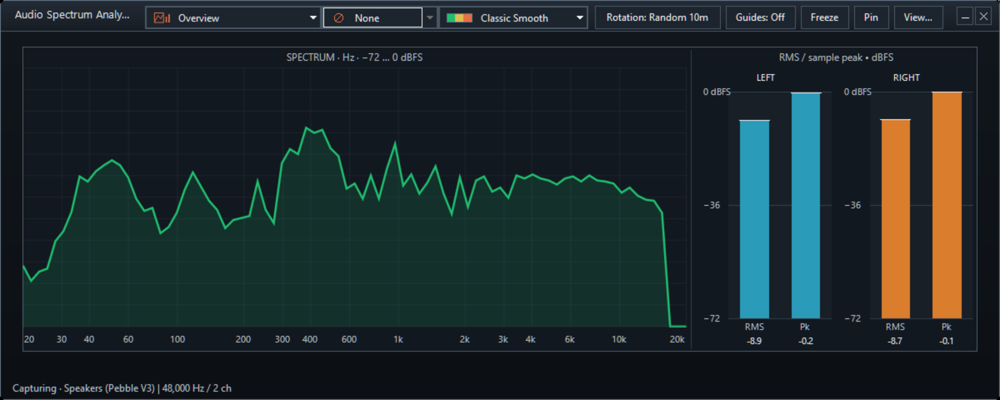</a>

_A combined view of the measured frequency spectrum and front-channel RMS and sample-peak levels._

### Spectrum

<a href="assets/images/Spectrum.png">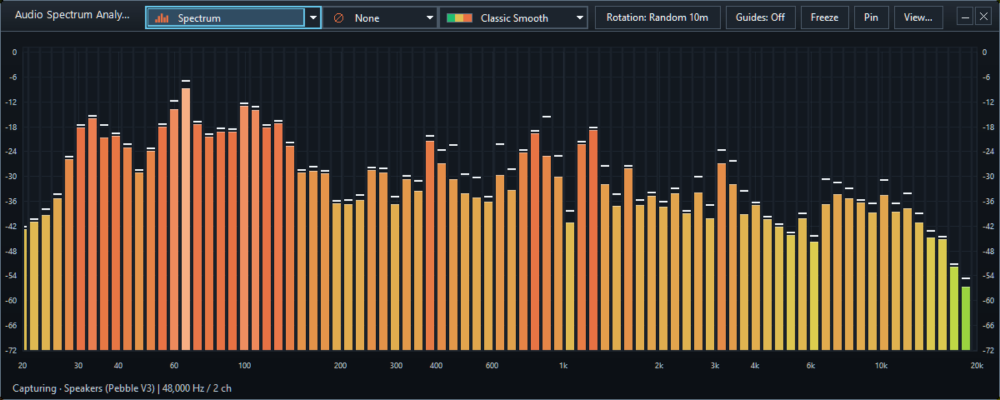</a>

_Continuous frequency-band levels across the logarithmic spectrum._

### Bricks

<a href="assets/images/Bricks.png">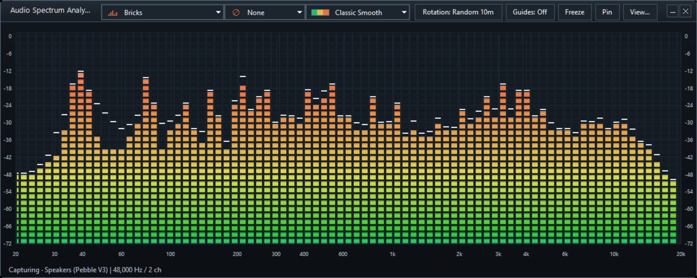</a>

_A block-style presentation of the same measured frequency bands._

### LED

<a href="assets/images/LED.png">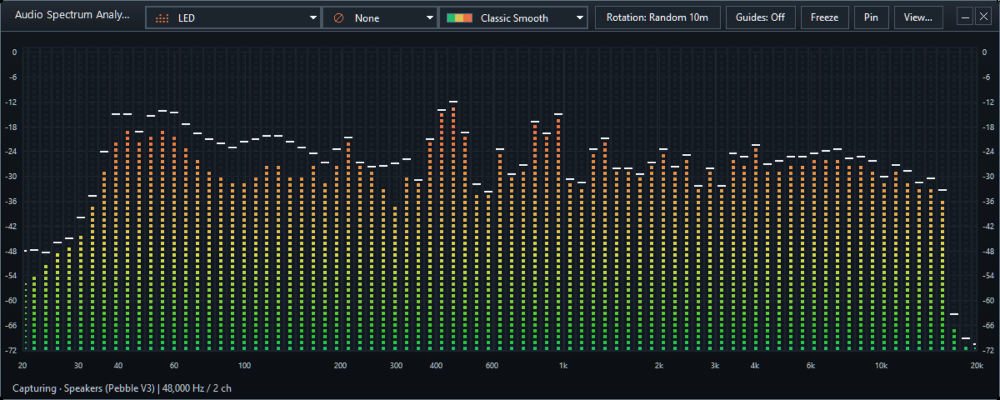</a>

_Segmented frequency meters with independent peak markers._

### Band Matrix

<a href="assets/images/BandMatrix.png">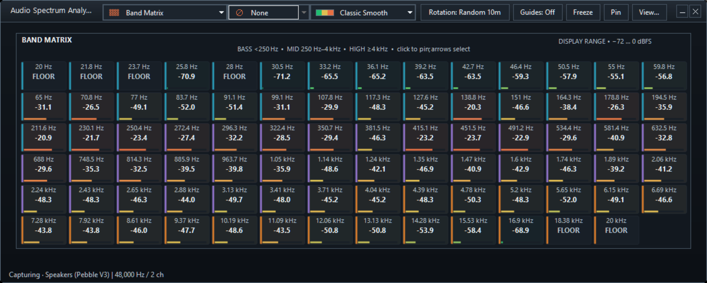</a>

_An 83-band inspector with grouped frequencies and a selectable pinned reading._

### Contour

<a href="assets/images/Contour.png">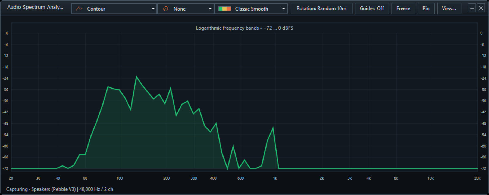</a>

_A connected contour of the current spectrum._

### Peak Trace

<a href="assets/images/PeakTrace.png">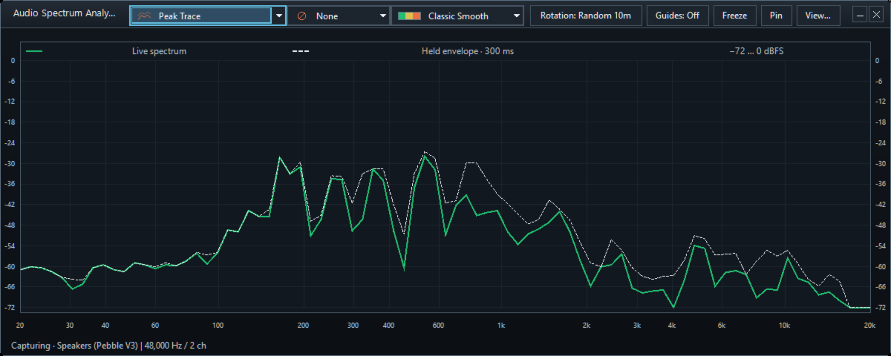</a>

_The current spectrum alongside a dashed held-peak envelope._

### Radial Spectrum

<a href="assets/images/RadialSpectrum.png">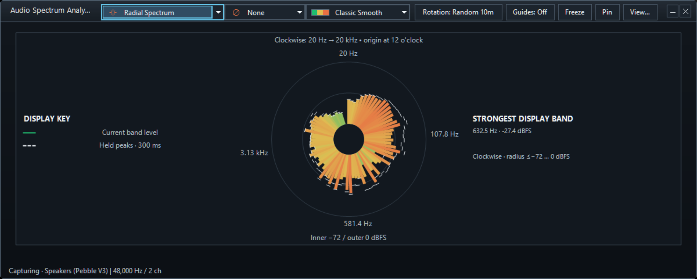</a>

_A circular spectrum with frequency references and a strongest-band readout._

### Stereo Spectrum

<a href="assets/images/StereoSpectrum.png">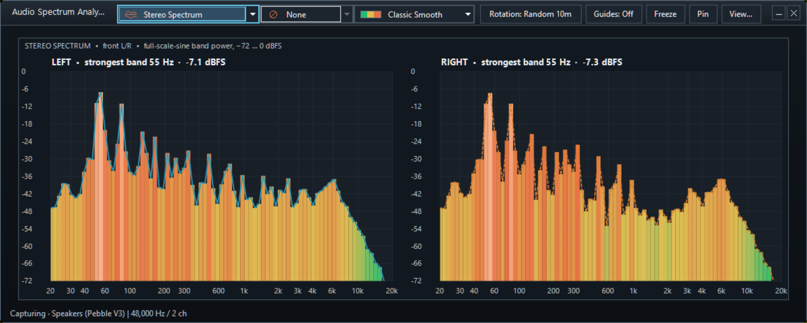</a>

_Independent front-left and front-right spectra on aligned scales._

### Stereo Compare

<a href="assets/images/StereoCompare.png">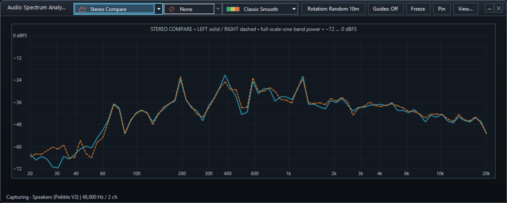</a>

_Compare independent channel spectra on shared frequency and level references._

### Stereo Levels

<a href="assets/images/StereoLevel.png">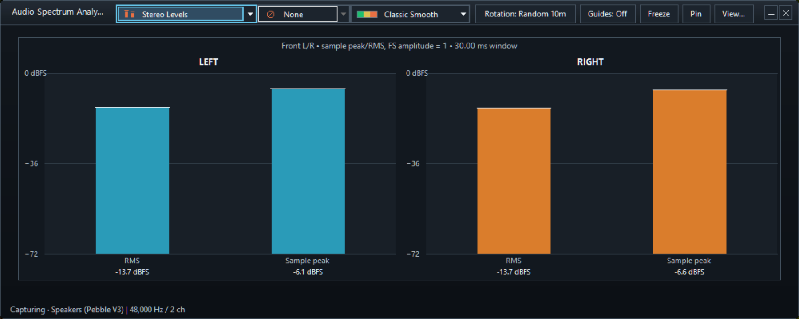</a>

_Channel RMS and sample peaks in amplitude-relative dBFS._

### Oscilloscope

<a href="assets/images/Oscilloscope.png">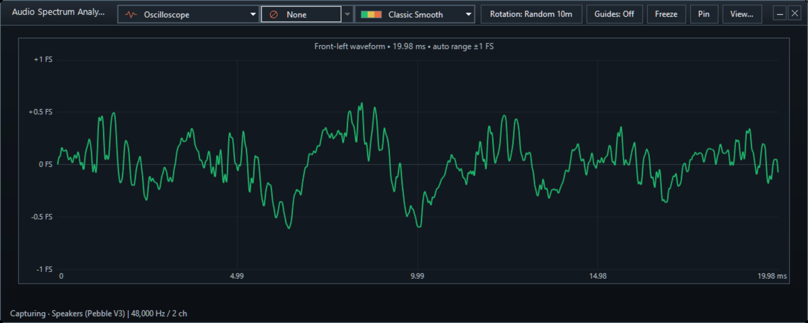</a>

_The captured front-left or mono waveform with a labeled auto-ranging amplitude scale._

### Octave Spectrum

<a href="assets/images/OctaveSpectrum.png">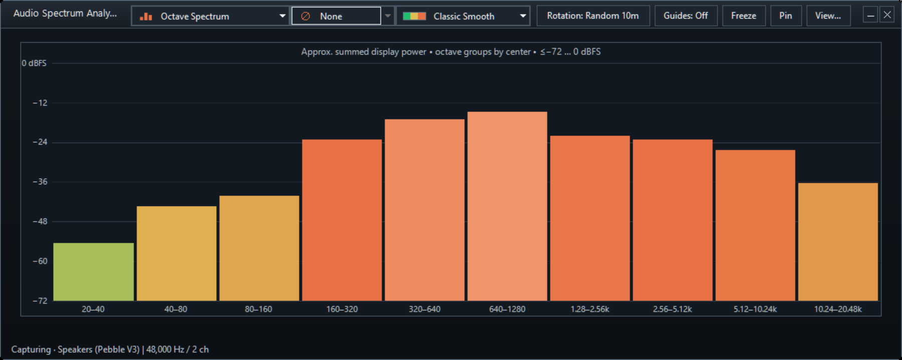</a>

_Ten octave-range groups reconstructed approximately from displayed band powers._

### Octave Waterfall

<a href="assets/images/OctaveWaterfall.png">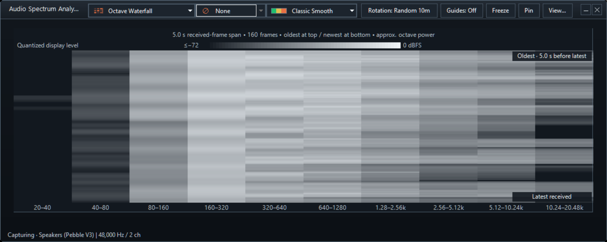</a>

_The coarse-resolution Waterfall view with an intensity legend._

### Waterfall

<a href="assets/images/Waterfall.png">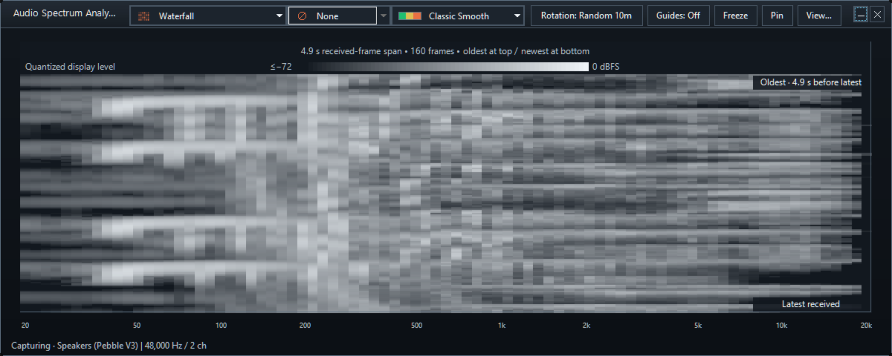</a>

_Frequency display history with an ordered intensity scale; rows represent received frames, not uniform sample time._

### Perspective History

<a href="assets/images/PerspectiveHistory.png">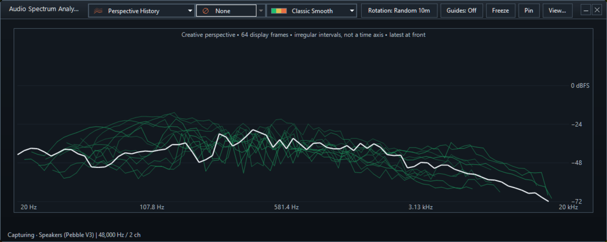</a>

_A creative perspective stack; depth represents received frames, not a uniform time axis._

### Dynamics History

<a href="assets/images/DynamicsHistory.png">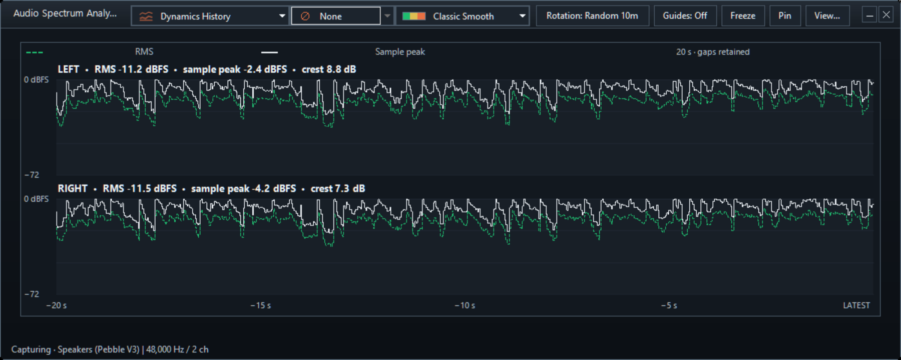</a>

_Actual front-channel RMS and sample-peak history with unavailable intervals preserved as gaps._

### Band Level Change

<a href="assets/images/BandLevelChange.png">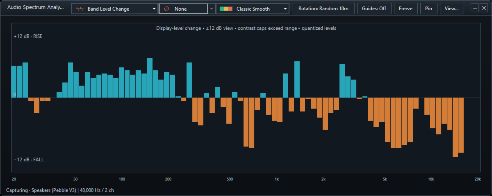</a>

_Per-band changes in displayed level with adjustable range and overflow markers._

### Threshold Monitor

<a href="assets/images/ThresholdMonitor.png">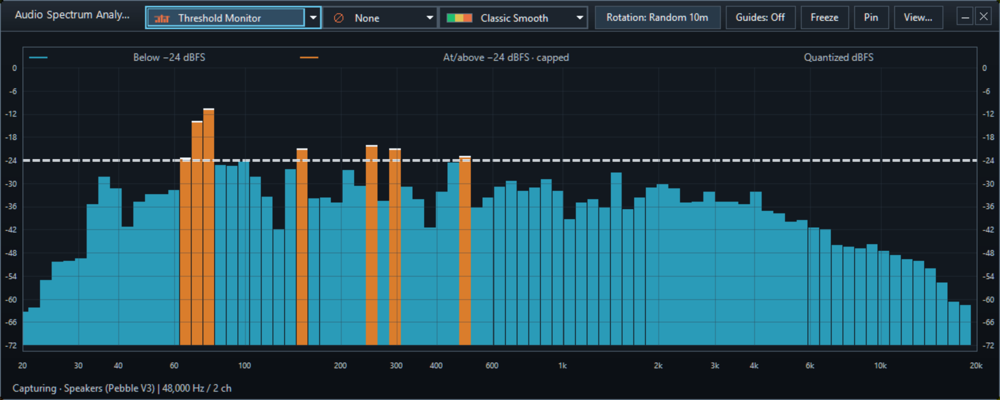</a>

_Band levels with stable below/above categories and threshold-crossing markers._

### Spectral Balance

<a href="assets/images/SpectrumBalance.png">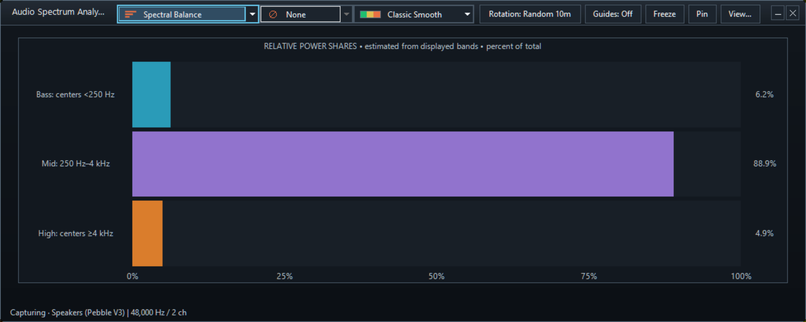</a>

_Estimated relative power shares with consistent bass, mid, and high identities._

### Advanced Spectral Balance

<a href="assets/images/AdvancedSpectralBalance.png">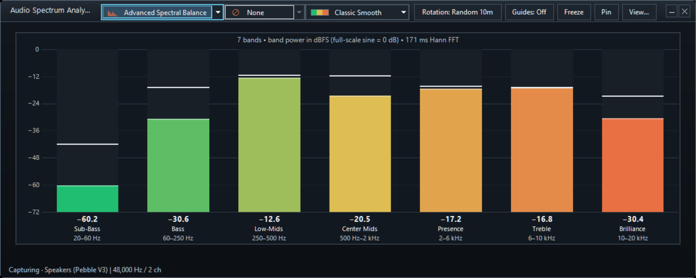</a>

_Seven FFT-measured bands in dBFS, using the full-scale-sine power reference._

<a id="measurement"></a>

## 📐 Measurement

### Signal pipeline

```mermaid
flowchart LR
    A[Windows audio output] --> B[WASAPI loopback]
    B --> C[Lock-free sample history]
    C --> D[DC removal + Hann window]
    D --> E[FFT]
    E --> F[One-sided bin power]
    F --> G[Stereo power average]
    G --> H[83 logarithmic bands]
    H --> I[dBFS mapping]
    I --> J[Time-based ballistics]
    J --> K[Visualization renderer]
```

> [!NOTE]
> The visual presentation does not hide the physical time/frequency trade-off described below; low-frequency bands intentionally use longer analysis windows for resolution.

**What a bar shows.** Bar _i_ is the power of the captured signal inside a fixed frequency band, in dB
relative to a full-scale sine (dBFS): a full-scale sine whose energy lies inside one band reads 0 dBFS.
The 83 bands are contiguous and logarithmically spaced (constant ratio ≈ 1/8.3 octave); band _i_ is centred
at 20·1000^(i/82) Hz and its edges are the geometric midpoints to its neighbours, so every frequency between
19.2 Hz and 20.9 kHz belongs to exactly one bar at a sufficiently high sample rate. The spectrum viewport
clips the first/last band geometry to 20 Hz–20 kHz; it does not change the integrated band powers or add
a frequency filter. At lower sample rates, band geometry follows the actual band plan and frequencies
above Nyquist remain unmeasured rather than stretching the data to 20 kHz. No frequency weighting,
bass/treble boost or per-frame normalization is applied, so pink noise reads flat and white noise rises
3 dB per octave.

**Pipeline.** WASAPI loopback (32-bit float) → lock-free sample history (written by the capture callback) →
each analysis tick (25 ms one-shot delay plus processing and scheduling): latest frames per channel → window-weighted DC removal → periodic Hann window → FFT →
one-sided bin power 2|X|²/(N·Σw²) (Parseval-normalized, so summed bins equal signal power) →
mean of left/right channel power (anti-phase content cannot cancel) → bin power integrated into each band
with fractional weights for bins that straddle a band edge → 10·log10 → fixed display range −72…0 dBFS mapped
linearly to bar height (levels below about −71.6 dBFS, the two lowest byte steps, are gated to an empty bar) → time-based presentation ballistics.

**Resolution.** Each band uses the shortest window that places at least 4 bins (the Hann main lobe) inside it:
≈85 ms above ~0.5 kHz, ≈171 ms around 0.3–0.5 kHz, ≈341 ms below (window lengths scale with the sample rate).
Short windows cut latency (a 1 kHz onset reaches 90 % in ~50 ms instead of ~150 ms with a single 341 ms
window); the long window keeps bass resolution. Below ~140 Hz the bars are narrower than the window's main
lobe (≈11.7 Hz at 48 kHz): a pure bass tone lights a small cluster of neighbouring bars, with the strongest
bar at the tone's frequency. Its own-band reading can be lower than the input level because power spreads
into neighbouring bands; the amount depends on frequency, sample rate, and band geometry. This is a physical time/frequency limit, not something the display hides.

**Stereo.** The front left/right pair is analysed separately and powers are averaged: L = R reads like mono,
one channel alone reads −3 dB, and phase between channels never changes the level. On multichannel devices
only the front pair is measured.

**Meter conventions.** The frequency spectrum uses a full-scale-sine power reference. PCM RMS and sample-peak meters instead use amplitude-relative digital full scale: a full-scale sine has approximately −3.0103 dBFS RMS and 0 dBFS sample peak. These legacy displays do not claim calibrated LUFS, SPL, VU, standardized PPM, or oversampled true-peak measurement. The separate [Analysis Workbench](#workspaces) adds mono/stereo loudness and an oversampled true-peak estimate; these are not certified meter or acoustic sound-pressure measurements. Mono sources do not invent a second channel.

**Seven-band ranges.** Advanced Spectral Balance trims partially supported bands at the captured Nyquist limit and marks unreachable bands unavailable. For example, 32 kHz capture measures the final band over 10–16 kHz; 22.05 kHz capture measures 10–11.025 kHz. Exact range labels are omitted together when a compact canvas cannot fit them legibly. This view has an 800 ms held-peak interval followed by 24 dB/s decay, separate from the radial display's 300 ms hold. Its animation uses elapsed time and sleeps outside an active, visible, unfrozen seven-band view with supplied measurements.

**Captured silence.** A native zero-level hint is checked against actual PCM. Nonzero samples and FFT-window tails still undergo spectral analysis. Real captured zeros retain available zero channel spectra; missing current PCM remains unavailable. The PCM meters cover newly observed samples, while an FFT spans a longer window, so a silent current packet may coexist with a preceding tone's spectral tail.

**Timing (default Spectrum mode).** Attack: full-scale rise in 45 ms. Release: exponential, time constant
380 ms. Peak marker: 300 ms hold, then a linear fall, independent of the bar. Peaks track measured
targets as well as displayed levels, so a brief measured peak is retained before a slow bar attack
finishes. Marker geometry stays above the actual painted bar or cell, with a minimum physical gap;
a held peak naturally sits farther above a falling bar. Reserved space above full scale accommodates
the marker without erasing signal pixels or changing dB calibration. Independent visual clearance
falls at a controlled elapsed-time rate when old Trail marks or cells disappear; final collision
constraints are resolved before invalidation, allowing stable nonzero meters to stop repainting.
Bricks use ±2 px (≈0.5 dB) hysteresis so a level
hovering at a brick boundary does not flicker (steady-level display error ≤ ±1.44 dB). A 60 FPS setting is a target, not a guarantee of achieved refresh on a Windows Forms timer. Other visual modes keep their
own presentation presets. All modes retain the same window dimensions: layout never changes the
window's size or minimum size. Stereo Spectrum uses side-by-side panels in short viewports and
stacked panels when height permits, with cached readable fonts. All thirteen 6 dB grid levels remain;
labels are thinned only when space is insufficient, retaining endpoints when they fit. Full labels
return when space permits. Crowded frequency labels are omitted, not moved off their logarithmic guides.
Radial, time-domain, signed-change and grouped-octave views retain their own appropriate coordinates.

---

<a id="faq"></a>

## ❓ FAQ

> Common questions about high-frequency content and low-frequency response timing.

### The top bars are empty or much lower on some songs. Is something broken?

Not necessarily. Lossy encoders may remove high-frequency content, so bars above a recording's cutoff can correctly remain empty. Source sample rate and Nyquist also limit represented frequencies. Deterministic broadband-noise and tone tests validate the band mapping; music alone is not a numerical calibration reference.

### Why do bass bars move later than cymbals?

Resolving bass needs a longer analysis window (≈341 ms below ~280 Hz versus ≈85 ms above ~560 Hz), so bass
bars trail treble bars by roughly 0.1 s. This is the time/frequency trade-off of any FFT analyzer.

<a id="technical-notes"></a>

## 🔧 Technical Notes

> Implementation details for device-change recovery, stream-hang detection, and silence publication.

- Default render/Multimedia changes and selected-endpoint notifications are detected via `IMMNotificationClient` and request serialized recovery on a worker thread. Unrelated endpoint notifications do not interrupt healthy capture; unavailable capture can retry discovery.
- A hang detector monitors consecutive identical WASAPI levels and forces a device reset if the stream appears stuck
- Captured zero PCM publishes available zero spectra and bars decay with their release time. Nonzero PCM overrides a native zero-level hint; a lack of current captured frames is reported as unavailable.

Capture scheduling and recovery are implemented in `Analyzer.cs` and `CaptureGate.cs`; regression coverage is in `Spectrum.Tests`. See [Project Structure](#project-structure) for the main implementation boundaries and [Tests](#tests) for verification scope.

---

## Documentation links

[Documentation index](documentation.md) · [Dependency notices](THIRD_PARTY_NOTICES.md) · [Published documentation](https://gcfernando.github.io/spectrum-analyzer/documentation/) · [Project overview](https://gcfernando.github.io/spectrum-analyzer/) · [All developer projects](https://gcfernando.github.io/gcfernando/projects/)

### Verification and redistribution limitations

Spectrum provides measured frequency-band displays, PCM views, and FFT analysis. Screenshots demonstrate presentation rather than numerical calibration. See [Tests](#tests) for the distinction between automated regressions and desktop/audio integration checks.

Use the complete `Spectrum\bin\Release` output folder; the included native BASS libraries are x86, and an x64-named solution configuration is not an x64-native distribution. .NET Framework 4.8 and Windows remain required. WASAPI loopback observes the selected endpoint's combined output, rather than an isolated application session; exclusive/protected streams may not be accessible.

Bundled third-party binaries require the owner's redistribution/license authorization and appropriate notices before a production release. This checkout does not establish that authorization. Performance and compatibility depend on the hardware, selected source, installed decoders, display scaling, and workload.
